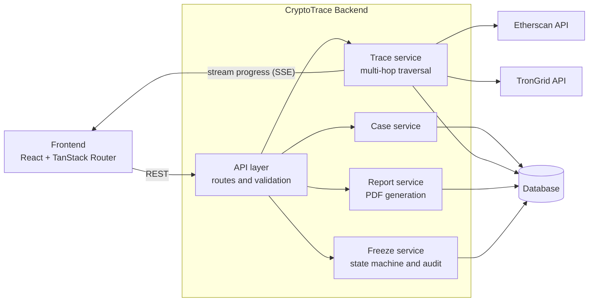
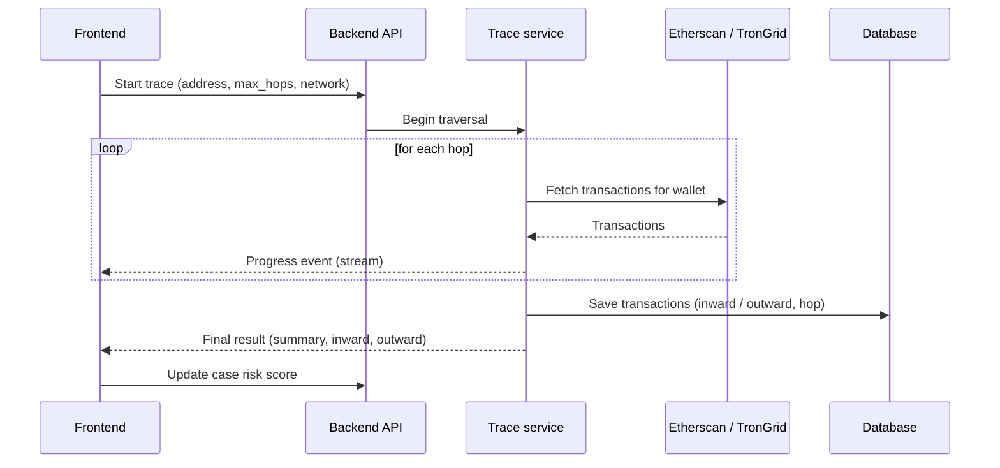
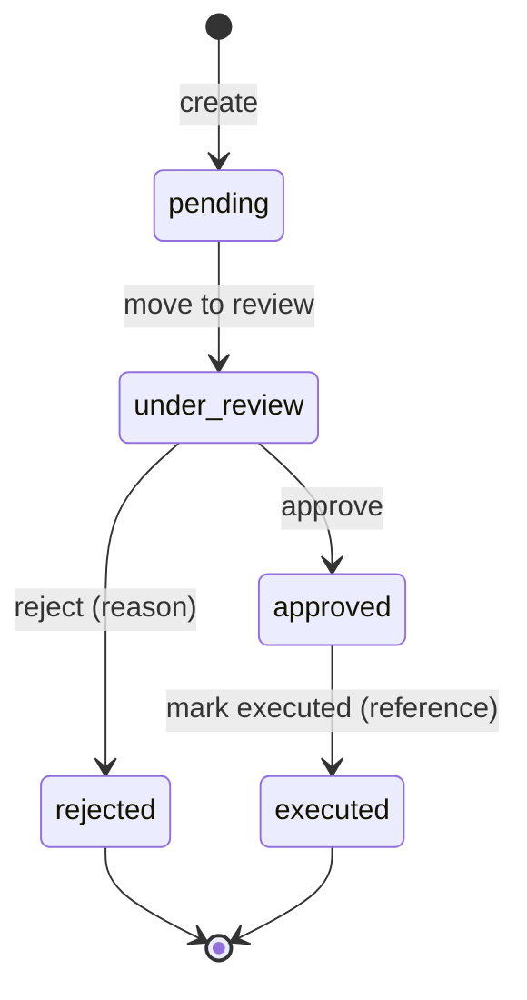

# CryptoTrace — Backend

> API server for the CryptoTrace digital asset investigation platform

This repository contains the **backend API**. It fetches on-chain transaction data, performs multi-hop wallet tracing, stores cases and evidence, generates PDF reports, and runs the freeze-request workflow.

The web UI lives in a separate repository: **[sih (frontend)](https://github.com/Mayur-web03/sih)**.

> Items marked `TODO` depend on your implementation. Fill them in to match your code.

---

## Responsibilities

- **Wallet tracing** for Ethereum (Etherscan) and TRON (TronGrid), hop by hop
- **Streaming trace progress** to the client while a trace runs
- **Case management**: create cases (optionally with `auto_trace`), update status and risk score
- **Transaction storage**: every traced transaction is saved per case so investigations can be reopened
- **PDF reports** for a case (case details plus traced evidence)
- **Freeze-request workflow** with a full audit trail and PDF export

---

## Architecture



### Trace flow



### Freeze request lifecycle



Every transition is written to an audit log (`action`, `performed_by`, `created_at`).

---

## Tech stack

| Area | Tech |
|---|---|
| Language / framework | `TODO` (e.g. Python + FastAPI, or Node + Express) |
| Database | `TODO` (e.g. PostgreSQL / SQLite) |
| Blockchain data | Etherscan API (Ethereum), TronGrid API (TRON) |
| PDF generation | `TODO` (e.g. ReportLab, PDFKit) |
| Streaming | Server-Sent Events for trace progress (`TODO` confirm) |

---

## API overview

Paths below are inferred from what the frontend calls. `TODO`: adjust to your actual routes.

### Tracing

| Method | Endpoint | Description |
|---|---|---|
| GET/POST | `/trace/stream` | Ethereum trace with streamed progress and final result |
| GET/POST | `/trace/tron` | TRON trace (`address`, `max_hops`, `asset_type`: `all`, `trx`, `trc20`) |

Trace limits: Ethereum 1 to 10 hops, TRON 1 to 5 hops.

### Cases

| Method | Endpoint | Description |
|---|---|---|
| GET | `/cases` | List all cases |
| POST | `/cases` | Create a case (`complaint_id`, `primary_wallet`, `chain`, `status`, `priority`, `auto_trace`, `max_hops`, `asset_type`) |
| PATCH | `/cases/{id}` | Update a case (for example `risk_score`) |
| GET | `/cases/{id}/transactions` | Saved traced transactions for a case |

### Reports

| Method | Endpoint | Description |
|---|---|---|
| GET | `/cases/{id}/report` | Download the investigation report (PDF) |

### Freeze requests

| Method | Endpoint | Description |
|---|---|---|
| POST | `/freeze-requests` | Create (`case_id`, `reason`, `triggered_by`) |
| GET | `/cases/{id}/freeze-requests` | List requests for a case |
| GET | `/freeze-requests/{id}/audit` | Audit log |
| POST | `/freeze-requests/{id}/review` | Move to review |
| POST | `/freeze-requests/{id}/approve` | Approve (`reviewer`) |
| POST | `/freeze-requests/{id}/reject` | Reject (`rejection_reason`, `reviewer`) |
| POST | `/freeze-requests/{id}/execute` | Mark executed (`execution_reference`, `execution_details`, `executed_by`) |
| GET | `/freeze-requests/{id}/pdf` | Download freeze request PDF |

---

## Data model (summary)

**Case**: `id`, `complaint_id`, `primary_wallet`, `chain`, `status` (New, Investigating, Action Required, Closed), `priority`, `risk_score`, `amount_inr`, `victim_name`, `fraud_type`, `assigned_investigator`, `updated_at`

**Transaction**: `tx_hash`, `from_address`, `to_address`, `value_wei`, `hop`, `direction` (inward / outward), `block_number`, `timestamp`, `is_error`

**FreezeRequest**: `id`, `case_id`, `status`, `reason`, `triggered_by`, `rejection_reason`, `execution_reference`, `execution_details`

**FreezeRequestAudit**: `id`, `request_id`, `action`, `performed_by`, `created_at`

---

## Getting started

### Prerequisites

- `TODO` runtime (Python 3.11+ or Node 18+)
- Database instance
- Etherscan API key and TronGrid API key

### Setup

```bash
git clone https://github.com/Mayur-web03/<backend-repo-name>.git
cd <backend-repo-name>

# TODO: install dependencies
# pip install -r requirements.txt   OR   npm install
```

### Environment variables

Create a `.env` file (never commit it):

```env
ETHERSCAN_API_KEY=your_key_here
TRONGRID_API_KEY=your_key_here
DATABASE_URL=your_database_url
CORS_ORIGINS=http://localhost:5173
PORT=8000
```

### Run

```bash
# TODO: replace with your start command
# uvicorn main:app --reload   OR   npm run dev
```

The frontend expects the API at the URL set in its `VITE_API_BASE_URL`.

---

## Security notes

- Keep API keys in environment variables, never in the repo
- Restrict CORS to your frontend origin
- Authentication and role checks (investigator, supervisor, FIU liaison) are recommended before production use
- The backend only **reads** blockchain data. It does not hold private keys or move funds.
- A freeze request is an internal auditable record. Real enforcement needs an exchange, custodian or authority integration.

---

## Related repositories

- Frontend: [sih](https://github.com/Mayur-web03/sih)
